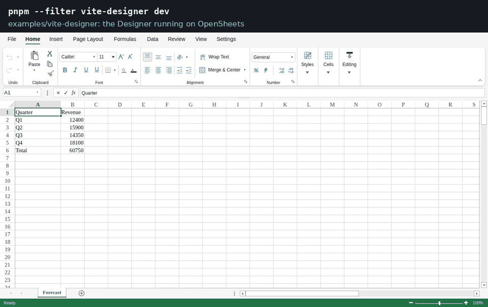
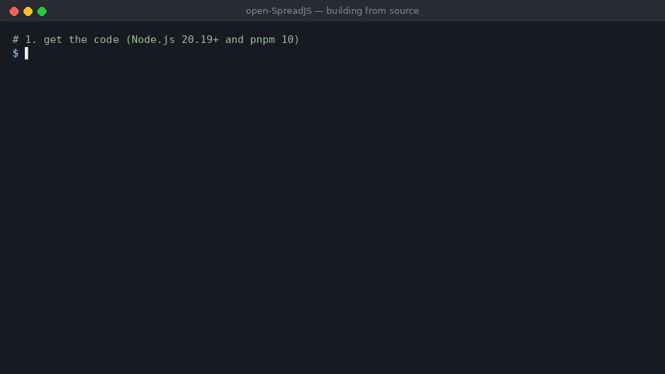

# OpenSheets

A clean-room, drop-in compatible reimplementation of the
[SpreadJS](https://developer.mescius.com/spreadjs) 19.2.5 public API
(`GC.Spread.Sheets.*`) — our own TypeScript code, canvas rendering, MIT-licensed.

An application written against `@mescius/spread-sheets` switches to OpenSheets by
changing **only its install aliases** — no code changes:

```json
{
  "dependencies": {
    "@mescius/spread-sheets": "npm:@opensheets/spread-sheets@^0.1.0",
    "@mescius/spread-sheets-react": "npm:@opensheets/spread-sheets-react@^0.1.0",
    "@mescius/spread-sheets-io": "npm:@opensheets/spread-sheets-io@^0.1.0",
    "@mescius/spread-sheets-designer": "npm:@opensheets/spread-sheets-designer@^0.1.0",
    "@mescius/spread-sheets-designer-react": "npm:@opensheets/spread-sheets-designer-react@^0.1.0",
    "@mescius/spread-sheets-designer-resources-en": "npm:@opensheets/spread-sheets-designer-resources-en@^0.1.0"
  }
}
```

Every package installs under the official name through the `npm:` alias, keeps the same
`GC` namespace (ESM default/named exports, CommonJS `module.exports = GC`, UMD global
`window.GC`), the same stylesheet file names, and the same runtime behaviour wherever it is
implemented (see the status table below). This recipe is verified end-to-end from packed
tarballs by `pnpm dropin:check` (apps/dropin-check).

**Full migration guide:** [docs/MIGRATION.md](docs/MIGRATION.md) — the alias block for all
18 packages (17 one-to-one aliases + the Italian core resources package), bundler/CJS/script-tag notes, license-key behaviour, theme CSS names and the
known deviations. **Runnable apps:** [`examples/`](examples) (`vite-core`, `vite-react`,
`vite-designer`, `script-tag-umd`).

Requires Node.js 20.19+ and pnpm 10.




## Using the core

```ts
import GC from '@opensheets/spread-sheets';
import '@opensheets/spread-sheets/styles/gc.spread.sheets.excel2013white.css';

const workbook = new GC.Spread.Sheets.Workbook(document.getElementById('sheet')!);
const sheet = workbook.getActiveSheet();
sheet.setValue(0, 0, 'Total');
sheet.setValue(0, 1, '=1+2');
```

The core is framework-agnostic (pure canvas rendering; it also runs headless in Node for
data work). Sparse row/column storage with Fenwick prefix sums keeps a 1,000,000 x 16,384
virtual sheet cheap to open, scroll and edit — see [docs/PERFORMANCE.md](docs/PERFORMANCE.md).

## React

```tsx
import { SpreadSheets, Worksheet, Column } from '@opensheets/spread-sheets-react';
import '@opensheets/spread-sheets/styles/gc.spread.sheets.excel2013white.css';

export default () => (
  <SpreadSheets>
    <Worksheet name="Data">
      <Column index={0} width={120} />
    </Worksheet>
  </SpreadSheets>
);
```

`<SpreadSheets>`, `<Worksheet>` and `<Column>` accept the same props as the official
wrapper (`gc.spread.sheets.react.d.ts` contract). React only hosts the canvas and DOM
overlays; cell edits never re-render React.

## Designer

With the aliases above, application code keeps importing the `@mescius/...` names:

```ts
import GC from '@mescius/spread-sheets';
import '@mescius/spread-sheets/styles/gc.spread.sheets.css';
import '@mescius/spread-sheets/styles/gc.spread.sheets.excel2013white.css';
import { Designer } from '@mescius/spread-sheets-designer';
import '@mescius/spread-sheets-designer-resources-en';
import '@mescius/spread-sheets-designer/styles/gc.spread.sheets.designer.min.css';

new Designer(document.getElementById('designer-host')!, undefined, { /* custom config */ });
```

The Designer component (ribbon, formula bar, status bar, property panels, dialogs, context
menus, contextual tabs) follows the public designer API and the same config/command/customization
structure. React usage: `@opensheets/spread-sheets-designer-react` provides the `<Designer>` React
component with the official wrapper props (`config`, `initData`, `styleInfo`,
`designerInitialized`, ...). UI strings come from
`@opensheets/spread-sheets-designer-resources-en`. See [docs/DESIGNER.md](docs/DESIGNER.md).

## Status

API surface (generated from the official public declarations, `pnpm coverage:api`):
**classes 207/207, methods/functions 1796/1796, enums 252/252, declarations 1369/1369 (100%)**.
Declaration presence is not behavioral parity — the table below states what is *behaviourally*
verified. Details and evidence: [docs/STATUS.md](docs/STATUS.md),
[docs/API_COVERAGE.md](docs/API_COVERAGE.md), [docs/DESIGNER.md](docs/DESIGNER.md),
[docs/PERFORMANCE.md](docs/PERFORMANCE.md).

| Module | Status | Notes |
| --- | --- | --- |
| Workbook/Worksheet model, sparse storage | done | chunked sparse cells, Fenwick sizes, events, undo |
| Canvas rendering + interaction | done | viewport-only paint, rAF batching, edit, drag/fill, tabs |
| Formula engine (494 built-ins) | done | dependency graph, incremental recalc; 1373/1373 differential oracle cases |
| Styles & number formats | done | named styles, all CellRange accessors; 64-case format table verified vs trial |
| Tables, sort/filter, conditional formatting | done | 60 built-in table styles, all 20 icon sets vector-drawn |
| Data validation, cell types, comments, hyperlinks, outlines | done | legacy + threaded comments partial |
| Charts (12 families + DataCharts) | done | trial-byte-exact chartSpace JSON, canvas painter |
| Pivot tables (+panel, slicers, timeline) | done | engine + panel; GETPIVOTDATA, grouping, views |
| Sparklines (24 types), shapes, barcodes | done | EAN/UPC payloads decode with standard readers |
| Print / PDF | partial | `savePDF` with embedded TrueType subsets; print preview UI partial |
| IO plugin (XLSX/CSV/SSJSON) | partial | bounded XLSX read/write both directions vs trial; SJS + encryption unsupported |
| GC.Data (`TableView`), TableSheet, Gantt, ReportSheet | partial | see STATUS.md sections per module |
| Designer component | done (known deviations) | paired pixel gates vs the official Designer green except the documented DPR-2 text-coverage residuals (STATUS.md, TASK 57) |
| React / Designer React wrappers | done | same props as the official wrappers |

Unsupported declared API members exist for type compatibility and throw/warn
`NotImplemented` in dev builds; they are listed in the coverage report — nothing is silently stubbed.

## Packages

All packages are version `0.1.0` and alias one-to-one (see
[docs/MIGRATION.md](docs/MIGRATION.md) § 1 for the full alias block):

| npm name (`@opensheets/…`) | aliased official name | contents |
| --- | --- | --- |
| `spread-sheets` | `@mescius/spread-sheets` | core: model, sparse storage, canvas renderer, formula engine (494 built-ins), events, undo |
| `spread-sheets-react` | `@mescius/spread-sheets-react` | `<SpreadSheets>`, `<Worksheet>`, `<Column>` wrapper (official props) + script-tag UMD |
| `spread-sheets-io` | `@mescius/spread-sheets-io` | XLSX / CSV / SSJSON import & export plugin |
| `spread-sheets-barcode` | `@mescius/spread-sheets-barcode` | `BC_*` barcode formulas + cell types (EAN/UPC/QR/…) |
| `spread-sheets-charts` | `@mescius/spread-sheets-charts` | chart add-in surface (core also paints charts itself) |
| `spread-sheets-shapes` | `@mescius/spread-sheets-shapes` | shapes add-in surface (core also draws shapes) |
| `spread-sheets-print` | `@mescius/spread-sheets-print` | paginator / print model + preview |
| `spread-sheets-pdf` | `@mescius/spread-sheets-pdf` | `savePDF` with embedded TrueType subsets |
| `spread-sheets-languagepackages` | `@mescius/spread-sheets-languagepackages` | localized formula/language resources |
| `spread-sheets-ganttsheet` | `@mescius/spread-sheets-ganttsheet` | Gantt sheet add-in |
| `spread-sheets-pivot-addon` | `@mescius/spread-sheets-pivot-addon` | pivot engine + field-list panel add-in surface |
| `spread-sheets-reportsheet-addon` | `@mescius/spread-sheets-reportsheet-addon` | report sheet add-in |
| `spread-sheets-slicers` | `@mescius/spread-sheets-slicers` | slicers + timeline add-in surface |
| `spread-sheets-tablesheet` | `@mescius/spread-sheets-tablesheet` | `GC.Data` TableSheet add-in |
| `spread-sheets-designer` | `@mescius/spread-sheets-designer` | Designer component (ribbon, dialogs, status bar, commands) |
| `spread-sheets-designer-react` | `@mescius/spread-sheets-designer-react` | `<Designer>` React wrapper (official props) + script-tag UMD |
| `spread-sheets-designer-resources-en` | `@mescius/spread-sheets-designer-resources-en` | English UI strings (side-effect import) |
| `spread-sheets-resources-it` | *(no official package)* | Italian `it-it` culture + core UI strings (side-effect import, docs/MIGRATION.md § 7) |

## Performance

Measured against the official trial on the same machine/headless browser, our
production `dist` builds — full tables in [docs/PERFORMANCE.md](docs/PERFORMANCE.md):

| | @opensheets | official trial 19.2.5 |
| --- | ---: | ---: |
| Open a 1,000,000 x 16,384 virtual sheet | **0.3 ms** | 1,164 ms |
| `setArray` 200,000 x 20 values | **6.9 s** | 230 s (33x) |
| `setValue` 100k cells (suspendPaint) | **309 ms** | 6,633 ms |
| Write + recalc a 100k-deep formula chain | **1.1 s** | 8.0 s (7x) |
| 100k pairwise-distinct `Style` objects + paint | **0.6 s** | ~15 s (24x) |
| Scroll 1000 rows (p95 per step) | **19.0 ms** | 34.4 ms |
| JS heap after full benchmark | **131 MiB** | 246 MiB |
| Core all-in bundle (min/gzip) | **559 KiB gz** | 1.86 MiB gz |
| Designer bundle (min/gzip) | **819 KiB gz** | 1.96 MiB gz |

Sparse chunked storage with Fenwick prefix sums (O(log n) hit-testing), viewport-only
canvas painting batched in `requestAnimationFrame`, and a parse-once dependency-graph
calculation service. `Workbook`/`Designer` create/destroy cycles leak nothing (WeakRef +
heap-snapshot verified).

## Building from source



The animation is a real run on a fresh clone of this repository (Linux, Node.js 20.20, pnpm 10.34):
`pnpm install` took 7 s with a warm store, `pnpm build` 188 s, `pnpm test` 85 s and `pnpm lint` 31 s.

1. **Prerequisites** — Node.js 20.19 or newer and pnpm 10 (`corepack enable` gives you pnpm).
2. **Clone** — `git clone https://github.com/TomP321/open-SpreadJS.git && cd open-SpreadJS`
3. **Install** — `pnpm install` installs the 27 workspace projects (packages, apps, examples).
4. **Build** — `pnpm build` builds every package with tsup (ESM, CommonJS, UMD/script-tag bundles, `.d.ts`,
   theme CSS) and the apps/examples with Vite.
5. **Test** — `pnpm test` runs the Vitest suites of every package (about 3,700 tests: 2,982 in the core, 351 in the
   Designer, 255 type-conformance tests in `packages/compat`, ...); `pnpm lint` runs ESLint on the whole workspace.
6. **API coverage** — `pnpm coverage:api` compares our public surface with the official `gc.spread.sheets.d.ts`
   (207/207 classes, 1796/1796 methods, 252/252 enums).
7. **Run it** — `pnpm --filter vite-designer dev` (or `vite-core`, `vite-react`) starts an example app.
8. **Optional: drop-in check** — `pnpm setup:compare` downloads Chromium for Playwright, then
   `pnpm dropin:check -- --pack` packs the packages into tarballs, installs them under the official `@mescius/*` names
   in throw-away apps and checks that they build and render.

## Development

```sh
pnpm install
pnpm -r build && pnpm -r typecheck && pnpm -r test && pnpm lint
pnpm coverage:api      # API surface report
pnpm dropin:check -- --pack   # install-from-tarball drop-in verification
pnpm compare           # playground/compare apps (see apps/*/README)
```

`apps/compare` and `apps/designer-compare` render the official trial package side by side
with ours in the same browser for black-box pixel/behaviour diffing; the Playwright specs in
those apps are the visual parity gates. The `examples/` apps are workspace members, so
`pnpm -r build` typechecks and builds them together with the packages.

## How this project was built

OpenSheets was written by AI coding agents under the direction of the repository owner. Nobody typed the code by
hand; the human set the goals, the priorities and the rules, and tested the results.

**Supervisor — Claude (Anthropic), running in [Claude Code](https://claude.com/claude-code).** The supervisor
(currently Claude Opus 5.5) never wrote the bulk of the code. It:

- split the roadmap into tasks (`.supervisor/task-FNN.md`, not in this repository) with the clean-room rules, the files
  each coder may touch, the acceptance gates and the official behaviour to reproduce;
- launched and watched the coders, audited every result before accepting it (deleted or weakened tests, unsafe
  `as unknown as` casts, binaries, anything that looked like pixels or code copied from the official product), merged
  the work in a separate git worktree and re-ran every gate itself (`build`, `coverage:api`, `typecheck`, `test`, `lint`,
  `dropin:check`);
- checked the UI with its own eyes through [web-vision](https://github.com/TomP321/web-vision) — official trial and
  OpenSheets side by side in `apps/designer-compare` — and turned the differences into new tasks.

Claude Code features that made this possible: background shell jobs for the long gate runs, the `Monitor` tool on a
watcher script (coder stopped, idle for too long, round finished, memory low), a self-paced `/loop` with
`ScheduleWakeup` as a heartbeat so the work went on day and night, persistent memory files for the project rules and
lessons learned, git worktrees for clean merges, and the web-vision MCP server for screenshots and browser actions.

**Coders.**

| When | Coder | Model | Where it ran |
|---|---|---|---|
| 2026-11-06 → 11-18, on and off | [OpenAI Codex CLI](https://github.com/openai/codex) | OpenAI models (gpt-6.1-terra in the later runs) | cloud |
| 2026-11-06, briefly | dsh (DeepSeek harness), headless | DeepSeek flash | cloud |
| 2026-11-08 → today, the only coder since 11-18 | [opencode](https://opencode.ai) **v2.1.4**, `opencode run --auto` | **Strata Qwen3.8-Flash-Next** | **local**, two machines |

The two local Strata machines:

| | Machine 1 | Machine 2 |
|---|---|---|
| Weights | UD-IQ4_XS v3.1 (4-bit) | GSQ-RCO IQ3_XXS (about 3-bit) |
| Hardware | 4 × RTX 4060 Ti 16 GB, 118 GB RAM | 1 × RTX 3060 12 GB, 62 GB RAM |
| Engine | Strata inference server, OpenAI-compatible API, one session (`parallel 1`) | same engine, reached through an SSH tunnel |
| Context | 512k tokens (524,288) | 512k tokens (524,288) |
| Speculative decoding | MTP draft layer, 4 draft tokens | MTP draft layer |
| Throughput | about 38–40 tokens/s | about 40 tokens/s |
| Reasoning effort | medium | low (the 3-bit weights tended to over-think) |

**The harness around opencode.** Each machine runs one queue (`feature-queue.sh`):

1. It starts `opencode run --auto` with the task file as the prompt.
2. It ends the round when the context reaches about 360k tokens or the coder stops early. It then commits a checkpoint
   and starts a fresh round with a short "continue from the checkpoint" prompt.
3. At the end it runs the gates and commits.

Because a killed `opencode run` client does not stop its session inside the background `opencode serve` service, the
queue also deletes the old session (`opencode session delete`). Otherwise two sessions would share one GPU server.
The coders used web-vision from inside opencode, through its MCP integration plus a small hooks plugin. With it they
looked at their own UI changes and measured the official Designer as a black box.

**Clean room.** The contract is the public `.d.ts` files and the public documentation. The official trial package was
used only as a black box, running side by side in `apps/compare` and `apps/designer-compare`. Nobody (neither the
supervisor nor any coder) opened its minified JavaScript or CSS, and no official pixels, icons or strings files were
copied. See [Clean-room](#clean-room).

## Clean-room

The implementation was written from the official public **type declarations** and public
documentation only. Official implementation bundles and stylesheets were never read; the
official trial was used purely as a black-box reference (screenshots and public API output).
All icons and glyphs are our own vector drawings. See [AGENTS.md](AGENTS.md).

## License

[MIT](LICENSE) — see the `LICENSE.md` shipped with each package. SpreadJS is a trademark of
GrapeCity International dba MESCIUS; OpenSheets is an independent implementation and is not
affiliated with or endorsed by MESCIUS.
